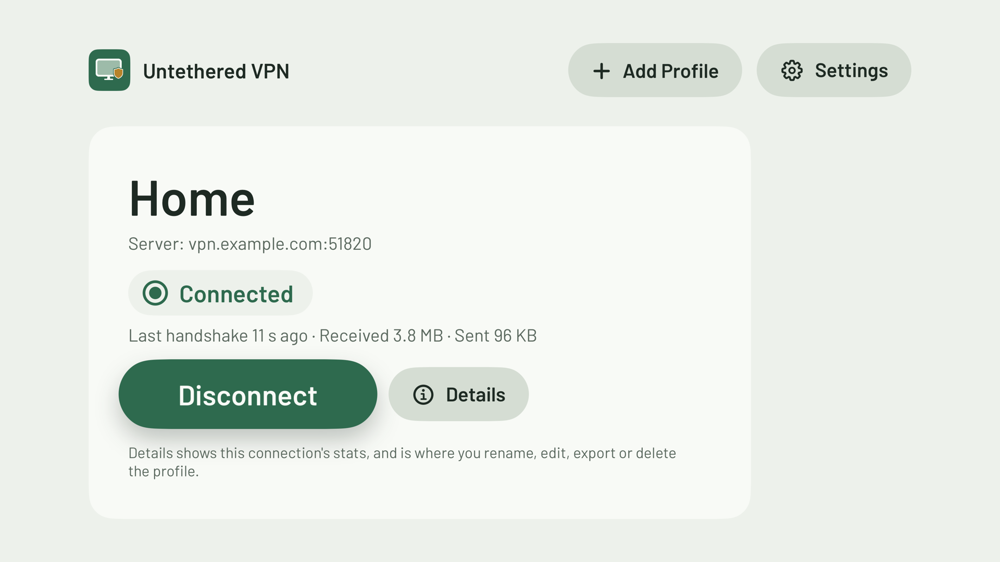

<h1 align="center">Untethered VPN</h1>

<b>Your home network, on your Apple TV, anywhere.</b> 
A free, open-source tvOS client for WireGuard® that connects your Apple TV to the server you already run.

  <picture>
    <source media="(prefers-color-scheme: dark)" srcset="docs/images/home-screen-dark.png">
    
  </picture>

  Free and open source · No accounts · No ads, analytics or tracking · No subscription

---

## Status: beta

Untethered VPN works, and it's in daily use on the maintainer's Apple TV, including from away from home. It's still a **beta**: expect rough edges, and please [open an issue](../../issues) when something doesn't work or isn't clear. There's no App Store version. You build it yourself and install it on your own Apple TV.

## What it does

- Connects your Apple TV to a WireGuard server you run, so streaming apps reach the internet through your home connection while you're travelling.
- Shows the connection's status and live stats (data sent and received, time since the last handshake) on the home screen.
- **Connect Automatically** brings the tunnel back up after a restart, sleep or network change.
- Holds several profiles, with your keys kept in the Apple TV's Keychain.
- Works with the Siri Remote alone.

## What you need

- An **Apple TV** on **tvOS 26** or later
- A **paid Apple Developer account** (the free account can't sign VPN extensions)
- A **Mac** with **Xcode 27** (with the tvOS platform) and **Go 1.27** (`brew install go`)
- A **WireGuard server** you run, and a peer config for the Apple TV: the `.conf` file with `[Interface]` and `[Peer]` sections

## Build and install

1. Clone this repository.
2. Copy `Config.sample.xcconfig` to `Config.xcconfig` in the same folder (it's git-ignored) and set `DEVELOPMENT_TEAM` to your 10-character team ID (Xcode → Settings → Accounts). To use your own bundle IDs, change `APP_BUNDLE_ID` there too.
3. On the Apple TV, open Settings → Remotes and Devices → Remote App and Devices. In Xcode, choose Window → Devices and Simulators and pair the Apple TV. Turn on Developer Mode on the Apple TV if it asks.
4. Build and install from Xcode (scheme `UntetheredVPN`, your Apple TV as the destination), or from the command line as in [ARCHITECTURE.md](ARCHITECTURE.md#building). The first device build registers the App IDs, the App Group and the Network Extension capability on your team.

The build compiles wireguard-go for tvOS with `make`, which breaks on spaces in paths. If your DerivedData path has any, pass `-derivedDataPath` with a path that doesn't. Apps you install this way stop opening when the provisioning profile expires (a year for a paid account); rebuilding renews it.

## Adding a profile

On the Apple TV, choose **Add Profile**, then:

- **Use Your Phone:** scan the code on the TV with your iPhone's camera, then paste your config or choose its `.conf` file on the phone. The phone encrypts it before sending, and the TV shows what arrived for you to check before you choose Save.
- **Type It In:** enter each setting with the remote or your iPhone's keyboard.

The first time you save, tvOS asks to allow VPN configurations. Allow it.

## Hotels and guest networks

- **Sign-in pages:** finish the network's sign-in on the Apple TV before you connect. If the sign-in page won't appear, disconnect first, and turn off Connect Automatically for that profile until you're signed in.
- **Devices kept apart:** many hotel networks don't let your phone reach the TV, so Use Your Phone can't connect. Turn on your phone's Personal Hotspot, join it from the Apple TV in Settings → Network, and scan again. Or use Type It In.
- **Untrusted networks:** someone who can tamper with traffic on the same network could interfere with Use Your Phone. Import at home or over your hotspot, or use Type It In. [SECURITY.md](SECURITY.md) explains why.
- **Troubleshooting:** Settings → Tunnel Log shows recent tunnel messages, with keys and your server's address hidden, so it's safe to paste into an issue. A profile's Details → Export does the same for its settings.

## Contributing

Issues and pull requests are welcome. Please read [CONTRIBUTING.md](CONTRIBUTING.md) first, and report security problems privately as described in [SECURITY.md](SECURITY.md).

## Licence

Apache License 2.0 (see [LICENSE](LICENSE)). The name "Untethered VPN", its icon and the Untethered Citizens branding are not covered by the licence. If you publish your own version, please give it a different name and icon.

"WireGuard" and the "WireGuard" logo are registered trademarks of Jason A. Donenfeld. Untethered VPN is not affiliated with or endorsed by the WireGuard project.

Made by [Untethered Citizens](https://github.com/Untethered-Citizens), tools for living on your own terms.
